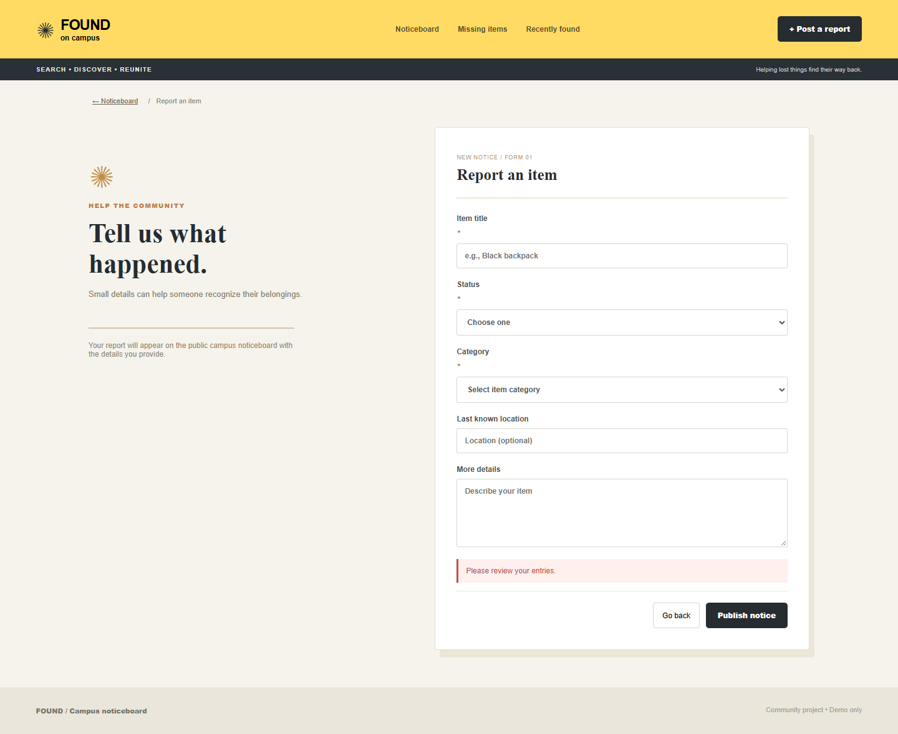
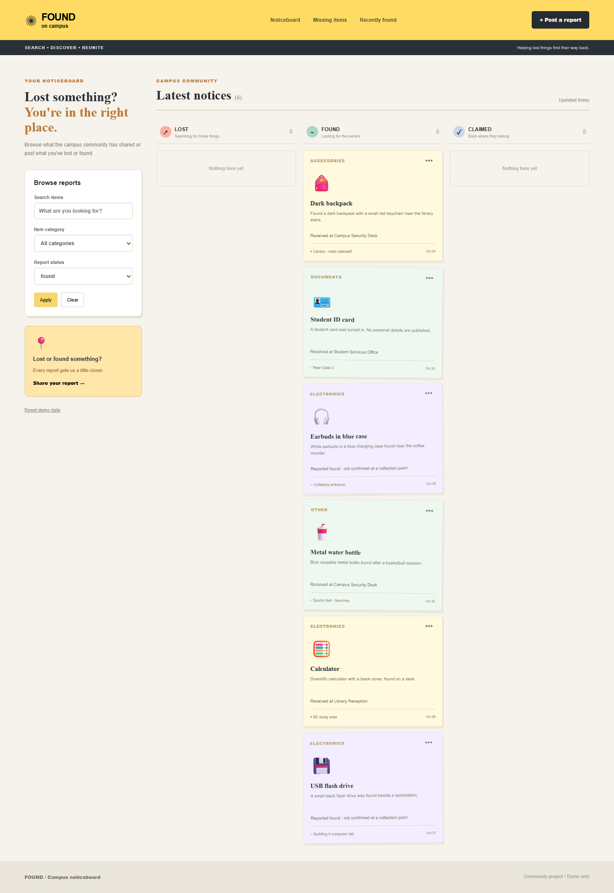
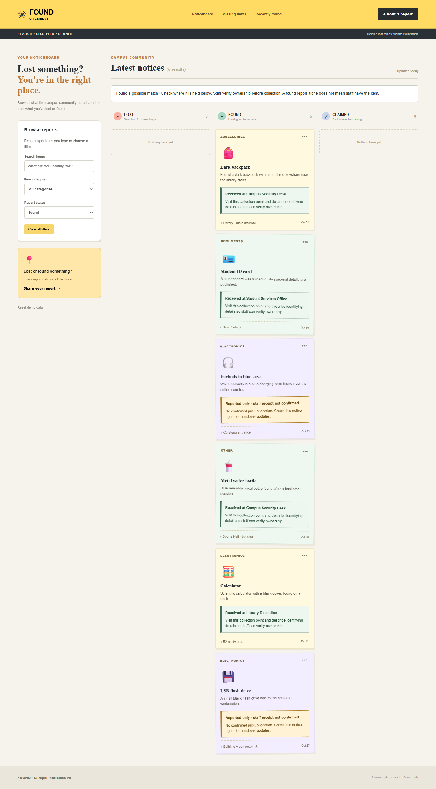
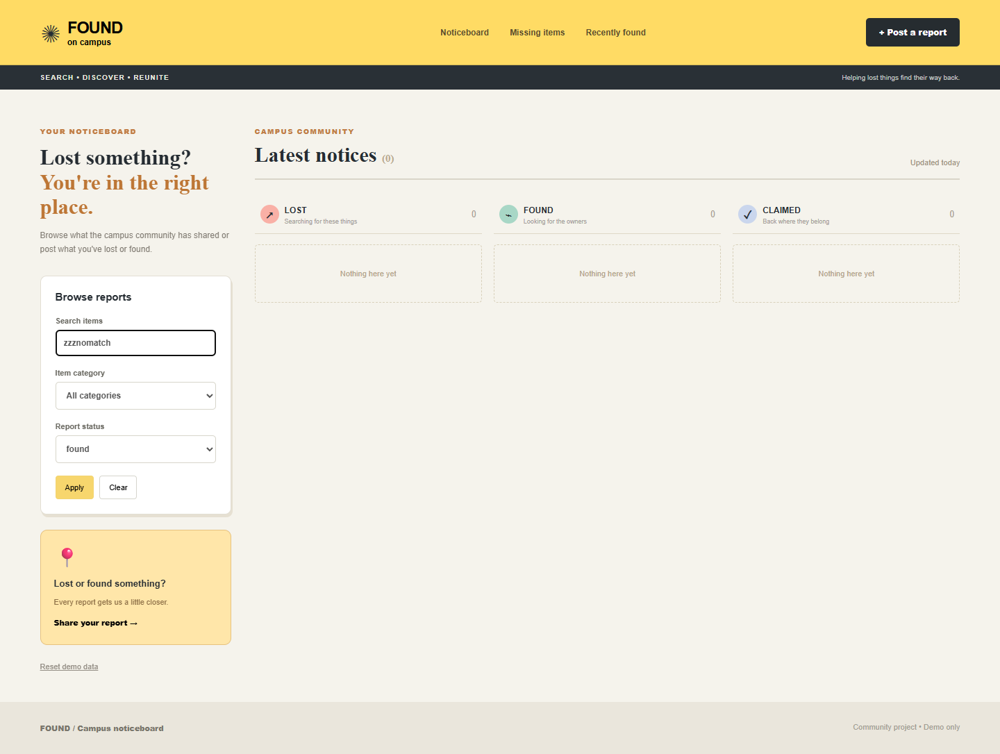
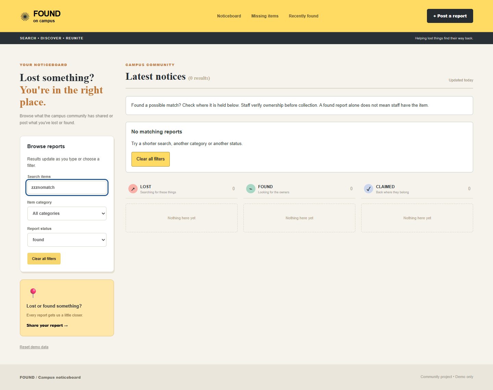
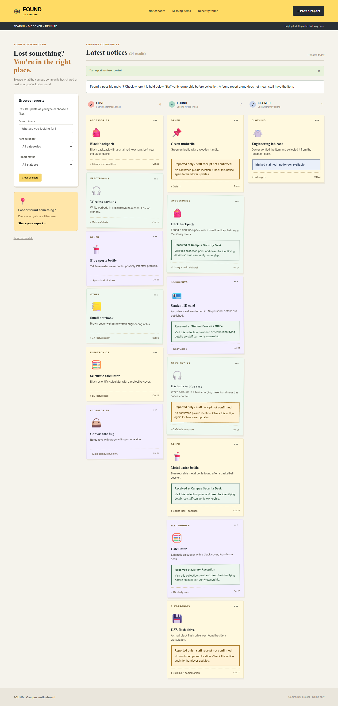
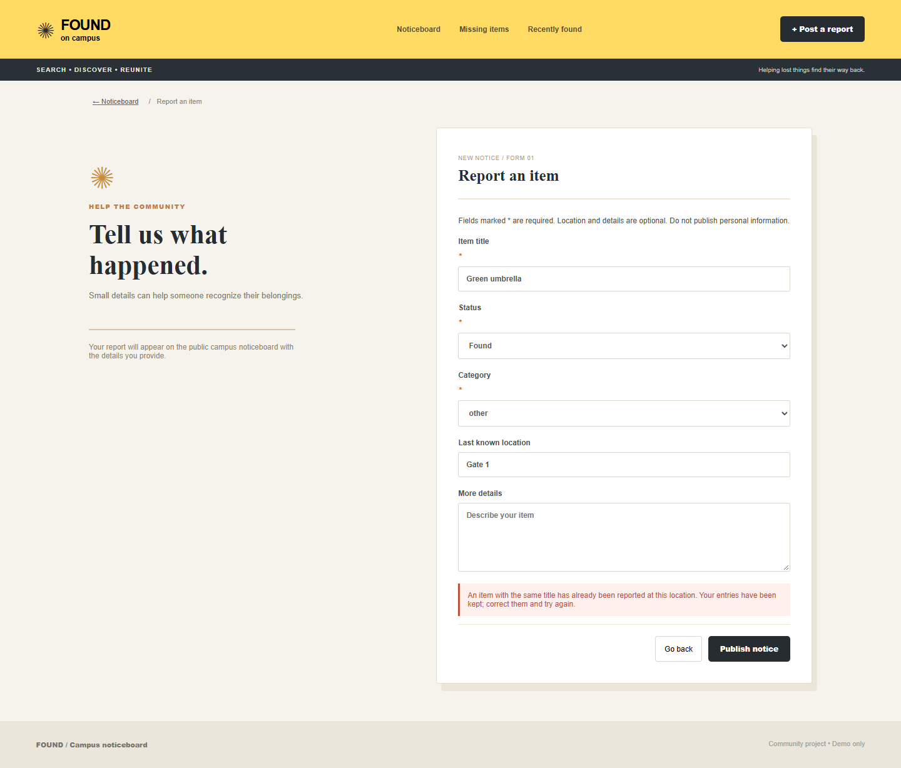
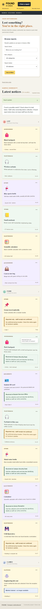
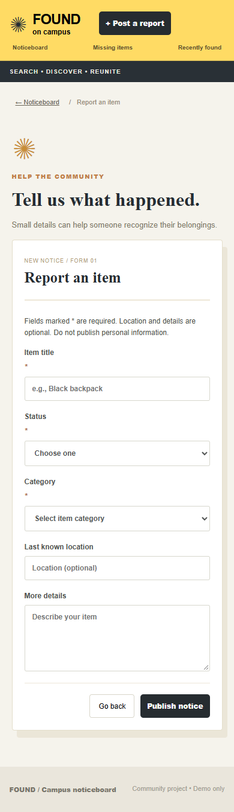

# Campus Lost & Found - UI/UX Rescue Challenge

## Deliverables

- Modified React component: [src/App.jsx](src/App.jsx)
- Modified stylesheet: [src/styles.css](src/styles.css)
- Six before/after screenshots and four demonstration/mobile screenshots: [evidence/screenshots](evidence/screenshots)
- Three usability problems, alternatives and justifications: below
- One rejected AI design suggestion: below
- Recorded browser test results: [evidence/test-results.json](evidence/test-results.json)

## User goals

A student who lost an item needs to find a matching report and understand whether it can be collected. A student who found an item needs to publish a valid report. Staff verify ownership before releasing property; a found report does not prove staff have received it.

## 1. Specific, actionable validation feedback

**Problem:** An invalid submission displayed only "Please review your entries." The student could not tell whether the title, category, status or duplicate rule caused the failure.

**Alternatives considered:** Native required-field validation is familiar but does not explain duplicate reports. Custom error text can use the existing validation rules and explain duplicate conflicts as well. Inline errors on every field would give more precise placement but require a larger form change.

**Chosen fix and justification:** Display the actual validation message in the existing alert and explain that entries have been preserved. This supports correction without guessing or retyping. All existing title, category, status and duplicate rules remain.

**Before - submitting an empty form:**

**After - the same unsuccessful action:**

## 2. Clear collection status and recovery guidance

**Problem:** Receipt information was small and gave no next step. A student could confuse an item reported found with an item actually held by staff, wasting a trip to a collection point.

**Alternatives considered:** A separate modal reduces card length but hides important information behind a click. A prominent panel makes cards longer but keeps receipt status and recovery instructions visible while browsing.

**Chosen fix and justification:** Put a clearly labeled panel directly in each relevant card. Confirmed reports name the collection point and explain ownership verification. Unconfirmed reports explicitly say staff receipt is unconfirmed and that no pickup location is confirmed. Claimed items say they are no longer available. Text communicates the meaning alongside color.

**Before - Found status filter:**

**After - the same Found status filter and example records:**

## 3. Predictable live filtering and useful empty results

**Problem:** Filters already updated immediately, but an Apply button suggested another step was required. An unsuccessful search showed only empty columns with no explanation or recovery guidance.

**Alternatives considered:** Delay updates until Apply is pressed, which makes the button consistent but adds a step to each search; or keep live filtering, explain it and remove Apply.

**Chosen fix and justification:** Keep immediate results, explain when they update, announce the result count, and add a no-results message with a Clear all filters action. Students can recover from an overly narrow search in one action.

**Before - search `zzznomatch`, Found status selected:**

**After - the same search and status:**

## AI suggestion rejected and refined

**AI suggestion:** "Use a separate collection-details modal to show pickup information."

**Decision:** Rejected the modal and refined the idea into a visible collection panel on each card. Students need to distinguish confirmed receipt from an unconfirmed report before deciding to travel. A modal would hide that distinction and add a click. The chosen panel shows receipt status and practical guidance directly, while staff still handle ownership verification. No claim or collection authorization workflow was invented.

## Demonstration of the main action

Created a Found report titled `Green umbrella`, category `Other`, location `Gate 1`, description `Green umbrella with a wooden handle.` The report appeared on the board, used unconfirmed receipt guidance, and remained after reloading the browser.

## Demonstration of an unsuccessful action

Attempted another report titled `Green umbrella` at `Gate 1`. The application rejected the duplicate, explained the conflict and retained the entered values.

## Verification

The modified production build passed using `npm run build`. The original version was independently built from Git HEAD for comparison. Screenshots were captured in headless Google Chrome at a desktop viewport of 1440 x 1050; mobile checks used 390 x 844. Full-page screenshots can be taller than the viewport. Both versions used the same seeded records and inputs for each comparison.

Automated browser checks passed:

- Empty search displays recovery guidance; Clear all filters restores all 13 example reports.
- Invalid form submission shows the specific title error.
- A valid Found report publishes and persists after reload.
- Duplicate title/location is rejected and form entries remain.
- The current user's report can be edited.
- Another student's report does not offer editing.
- Search, status and category filters combine correctly.
- Mobile board and form fit the viewport without horizontal overflow.
- No browser JavaScript errors were recorded.

These checks verify the listed interactions and viewport overflow; they are not a full accessibility audit or a user study. Detailed results are stored in [test-results.json](evidence/test-results.json).

**Mobile board:**

**Mobile form:**

## Run and submit

Run `npm install`, then `npm run dev`, and open the printed local URL. This is a standalone localStorage demo; no MongoDB or backend is required.

Submit this document together with `src/App.jsx`, `src/styles.css` and the entire `evidence/screenshots` folder so the embedded images remain available. Include the rest of the runnable project if requested by the instructor. The README does not specify an upload portal or filename convention.
